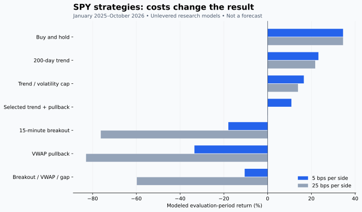

# SPY strategy study and bot plan — October 14, 2026

The evidence does not establish a best money-making strategy for this bot.
Keep creator execution and strategy research separate. The strongest next
research candidate is a simple trend/risk filter, but it has not earned live
promotion. The combination selected using 2023–2024 results underperformed
the passive benchmark in 2025–2026. Tested intraday variants lost money.

## Data and protocol

Retrieved authenticated, read-only Alpaca historical SIP data for SPY:

- 2,512 daily bars, October 14, 2016 through October 13, 2026; adjustment `all`.
- 157,490 unique 15-minute bars over that interval; adjustment `split`.
- 2,512 broker-calendar sessions; 21 scheduled early closes.
- Five identical bars overlapped yearly download boundaries. Verified exact
  equality before deduplication; conflicting duplicates are refused.
- Intraday evaluation excludes 22 sessions: the early closes plus a session
  without a complete regular-session grid. Missing prices are not invented.

SPY is an investable proxy for the S&P 500, not an independent reconstruction
of historical index constituents. The fund seeks the index's price and yield
performance. Daily adjusted results are total-return proxies; they are not
literal executable historical prices. Historical revisions, auction fills,
spread/depth, individual fees, taxes, cash interest and latency remain outside
the model. The $100 bot currently buys whole shares; fractional research
exposure does not prove it can execute these portfolios.

Rules were fixed before results. Six active daily candidates and four active
intraday candidates, plus cash and buy-and-hold benchmarks, were compared.
No parameter search was performed to maximize the final-period result.

| Period | Use |
|---|---|
| October 2016–October 2017 | Indicator warmup |
| October 2017–December 2022 | Development/regime review |
| January 2023–December 2024 | Candidate selection |
| January 2025–October 2026 | Later historical evaluation |

Selection ranks positive-return candidates with drawdown below 25% by
zero-cash-return Sharpe in the selection period. It chooses **50% 200-day
trend + 50% trend-conditioned RSI pullback**, without consulting final-period
results. A preliminary daily-only report and the full report select the same
candidate. The evaluation was then read; it is now consumed and cannot be
reused as an untouched holdout for future parameter changes. Session-calendar
and duplicate-data repairs corrected the model, not strategy parameters.

Daily signals use a completed closing bar and fill at the following open.
Daily exposure is long-only and capped at 100%; volatility targeting never
adds leverage. Intraday signals use completed 15-minute bars, fill at the
next open, allow one long trade per day, use a defined stop, and exit at the
15:45 bar open. Gap stops use the worse opening price; an old signal-bar low
cannot stop a trade before its entry. These are explicit approximations,
not exact reproductions of a trader's proprietary plan.

Costs tested: 1, 5, 10 and 25 basis points **per side**, combining hypothetical
fees, spread and slippage. A 5-bps side is 0.05%, not 5%. Intraday costs use
buy/sell price factors; daily rebalances use a turnover approximation.
Evaluation windows slice continuous portfolios, including carried positions;
they do not reset holdings or force a new benchmark purchase on January 1.

## What ten years of SPY show

| Daily adjusted-history statistic | Result |
|---|---:|
| Close-to-close cumulative return proxy | +325.70% |
| Annualized growth proxy | 15.65% |
| Maximum close-to-close drawdown | -33.79% |
| Positive daily-return intervals | 55.04% |
| Worst daily return | -10.78% |
| Best daily return | +10.50% |
| Annualized daily volatility | 17.68% |
| Mean previous-close to next-open return | 4.32 bps |
| Mean open-to-close return | 2.05 bps |

Long-run upward drift coexists with severe drawdowns and large daily moves.
Only about 55% of days were positive. Overnight and intraday mean returns
are small relative to individual-day volatility; their averages do not tell
the bot which particular day will rise. The 2018 and 2022 annual declines,
2020 drawdown/rebound and subsequent recoveries argue for regime review,
not a permanent 'SPY always goes up today' assumption. These are descriptive
statistics, not future return forecasts.

## Later-period comparison

January 2025–October 2026, baseline 5 bps per side. Returns below are modeled
period totals, not annual returns or predictions. Sharpe uses zero cash
return and has not been corrected for selecting among ten candidates.

| Model | Return | Max drawdown | Sharpe | Status |
|---|---:|---:|---:|---|
| Buy and hold | +34.49% | -19.77% | 1.06 | Passive benchmark |
| 200-day trend | +23.23% | -11.14% | 1.09 | Lower drawdown; future paper candidate, not selected ex ante |
| 50/200 trend | +16.11% | -10.14% | 0.82 | No demonstrated improvement |
| 20/10 channel breakout | +16.55% | -8.03% | 1.04 | Lower drawdown, less return |
| Trend-conditioned RSI2 pullback | -0.56% | -7.95% | ~0.00 | Rejected as standalone profit engine |
| Trend with 10% volatility target | +16.56% | -8.53% | 1.00 | Risk-control candidate, no superior-return proof |
| Selected 50/50 trend/pullback blend | +10.88% | -8.69% | 0.72 | Failed superiority gate |
| 15-minute opening-range breakout | -17.95% | -26.17% | -1.39 | Rejected |
| Breakout + VWAP confirmation | -17.95% | -26.17% | -1.39 | Same trades; redundant confirmation in this sample |
| VWAP pullback | -33.45% | -33.95% | -4.61 | Rejected |
| Breakout + VWAP + 0.2%–2% gap filter | -10.48% | -18.58% | -0.82 | Rejected |
| Cash, zero interest assumption | 0% | 0% | 0 | Operational fallback |

At 25 bps per side, the selected blend's gain falls to **+0.13%**. The
opening-range model loses about **76.25%**, and the VWAP pullback model about
**82.99%**. These deliberately adverse assumptions expose turnover risk;
they are not measured historical spreads. A strategy whose edge disappears
under modest execution uncertainty should not be promoted.

The selected blend versus benchmark paired 20-session block bootstrap uses
445 aligned intervals, 2,000 resamples and seed 20261014. Its annualized mean
return difference is -12.04 percentage points; the exploratory 95% interval
ranges from -26.60 to +0.89. The interval does not establish positive edge,
is not a profit probability, and is not a multiple-testing correction.



## Strategy families and suitability

No finite investigation can certify every strategy or the world's best day
trader. This catalog identifies what fits the bot's data, capital and current
capabilities, and what needs a different validation program.

| Family | Treatment for this bot |
|---|---|
| Passive index exposure | Benchmark; fractional capability needed for a $100 SPY account |
| Trend following / moving averages | Tested long/cash variants; promising risk-filter research, not profit certification |
| Time-series momentum | Research-supported family; multi-asset evidence does not prove single-SPY performance |
| Channel / support-resistance breakout | Tested closed-bar approximation; price touch alone is insufficient |
| Pullback / mean reversion | Tested simple RSI2 variant; failed later-period standalone test |
| Opening-range breakout | Tested 15-minute SPY version; rejected; not an exact 1/5-minute QQQ/TQQQ reproduction |
| VWAP / intraday trend | Tested session VWAP combinations; redundant or losing here |
| Gaps / gap fades | Gap filter tested; fade variant remains untested |
| News / macro / earnings | Preserve provenance and official release timing; no direct sentiment-to-order promotion |
| Creator alert copying | Existing bot purpose; source identity, complete contract and risk fields still required |
| Relative strength / sector rotation | Needs point-in-time multi-asset universe and survivorship-safe data |
| Value / quality / fundamental investing | Needs timestamped filings/fundamental vintages; not a day-trading substitute |
| Pairs / statistical arbitrage | Needs pairs, hedge coordination and borrow/cost data |
| Market making / scalping / order flow | Needs quotes, order-book depth and realistic latency; 15-minute bars cannot certify it |
| Options income / wheel / credit spreads | Unsupported short-option/assignment/multi-leg lifecycle; inappropriate to infer from SPY bars |
| Volatility / options arbitrage | Needs historical option chains, IV, greeks, quotes and coordinated hedges |
| Futures / leveraged ETFs | Different margin and leveraged risk; not promoted from these unlevered tests |
| ML / reinforcement learning | Needs substantially stricter search accounting, leakage controls and forward evidence |
| Martingale / doubling / averaging down | Excluded from the plan; no expansion of loss budget to rescue failed trades |

## What the trader research contributes

Andrew Aziz/Concretum's published ORB study concerns QQQ/TQQQ and leverage,
not a $100 unlevered SPY bot. QuantConnect's published recreation uses a
large stock universe, relative opening volume and five-minute ranges; its
reported backtest is not this study. Their claims were not treated as our
profit evidence. SMB's public training contributes repeatable playbooks,
stock selection, preparation, risk controls and trade review; public
education does not independently certify any person's 'best trader' status.

AQR's trend-following paper studies diversified markets over a long history.
It motivates a research family, not transplanting institutional returns into
one stock or small option account. Barber and colleagues' transaction-data
study reports negative aggregate day-trader performance after costs in its
Taiwan sample. That is a reason to test costs and reject failed hypotheses,
not a precise forecast for this specific bot.

Primary sources studied:

- https://www.ssga.com/us/en/individual/etfs/state-street-spdr-sp-500-etf-trust-spy
- https://docs.alpaca.markets/us/reference/stockbars
- https://docs.alpaca.markets/us/docs/market-data-faq
- https://concretumgroup.com/wp-content/uploads/2026/02/Can-Day-Trading-Really-Be-Profitable.pdf
- https://www.quantconnect.com/research/18444/opening-range-breakout-for-stocks-in-play/
- https://www.smbtraining.com/blog/how-to-day-trade
- https://bearbulltraders.com/research
- https://www.aqr.com/Insights/Research/Journal-Article/A-Century-of-Evidence-on-Trend-Following-Investing
- https://faculty.haas.berkeley.edu/odean/papers/Day%20Traders/Day%20Trading%20and%20Learning%20110217.pdf

## Incorporated engineering and practical plan

Added `spy_history.py`, `spy_strategies.py` and `strategy_advisory.py` to the
bot repository. They fetch read-only history, validate/deduplicate bars, obey
the historical session calendar, compare fixed strategies, record assumptions
and failures, and return a review-only strategy decision. They do not submit
orders, alter creator rules or enable a new autonomous strategy.

For the $100 example, the advisory also reports inability to buy one whole
SPY share at the issuer's October 13 closing price of $778.01. It never
converts an underlying-stock backtest into a recommendation to buy cheap
options. Fractional-share execution, if later implemented, requires its own
budget, fill and exit tests before it changes that result.

1. Keep the existing execution bot focused on authenticated, complete creator
   alerts. Research is a separate evidence stream.
2. Freeze simple 200-day trend/cash and volatility-capped trend as prospective
   paper candidates. They are new forward hypotheses, not newly validated
   winners chosen from the consumed final period.
3. Observe actual quotes, spreads, signal timestamps, simulated order latency,
   rejected trades and costs without changing the rules after losses.
4. Compare against passive exposure and cash using matched periods, actual
   capital constraints and explicit maximum loss budgets.
5. Review after at least 60 trading sessions and enough completed trades for
   meaningful uncertainty estimates. Sixty sessions alone do not certify edge.
6. Require independent forward evidence, realistic fills, broker/source
   readiness and explicit allocation before promotion. Stop or reject failing
   candidates. Do not turn repeated historical tuning into claimed validation.

## Grades and remaining limitations

| Area | Grade / conclusion |
|---|---|
| Research engineering | B: validated source data and timing/cost tests; not a professional tick-level simulator |
| Selected combination's profit evidence | C: positive base return, inferior benchmark Sharpe, fragile under cost stress |
| Tested SPY intraday approximations | F for promotion: negative later-period results |
| Simple trend as future research | B-minus hypothesis: lower drawdown, not independently certified forward |
| Overall bot readiness | B; prior source/deployment blockers remain |
| Guaranteed or forecast profit | Not established |

Regression tests cover future-bar isolation, next-open fills, gap stops,
pre-entry lows, costs, early-close calendars, invalid OHLC, duplicate/conflict
data, paired calendar sampling and refusal to turn a backtest into orders or
option profit. Sixteen focused checks passed; the final full repository suite
passed 2,876 tests with two deployment checks skipped. CI evidence is recorded
in the accompanying PR. Machine-readable results include dataset
hashes, all candidates/costs/splits and failed promotion gates.

Reproduce using private, authorized credentials kept outside git:

```bash
python -m lavish_core.validation.spy_history --directory /tmp/spy-history --env-file /path/to/private/alpaca.env
python -m lavish_core.validation.spy_strategies --daily /tmp/spy-history/spy-daily.json --intraday /tmp/spy-history/spy-15min.json --calendar /tmp/spy-history/calendar.json --output /tmp/spy-study.json
TRADE_MODE=dry DISCORD_WEBHOOK_URL='' python -m pytest -q validation_tests/test_spy_strategies.py
```

Raw market snapshots remain private. Public report artifacts contain derived
statistics, source provenance and hashes, not credentials or account data.
